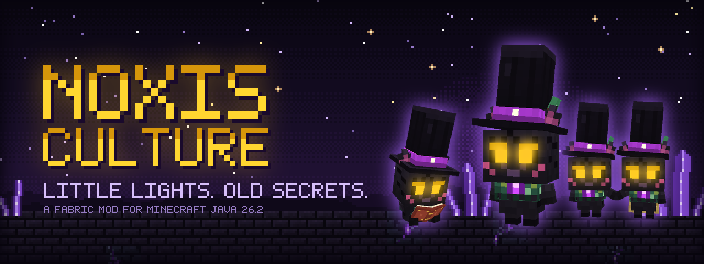
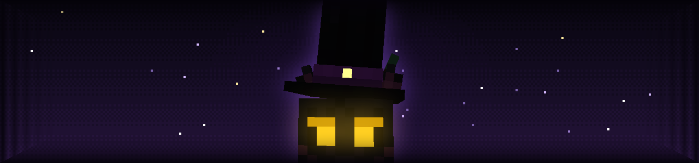
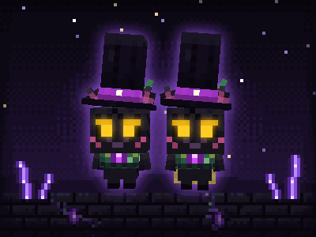
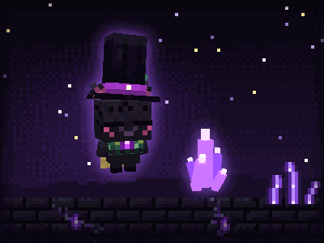
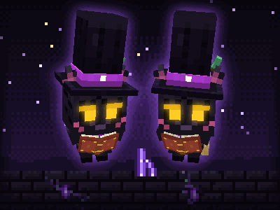
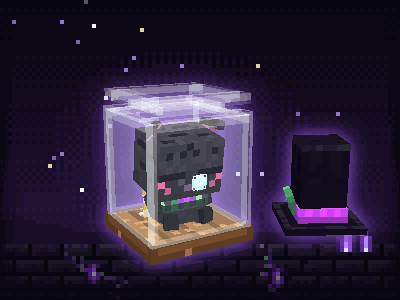
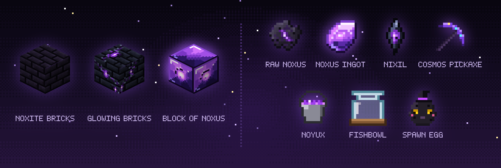
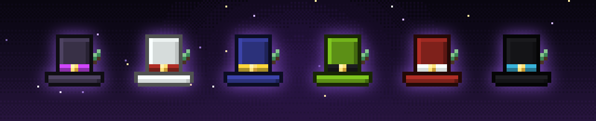
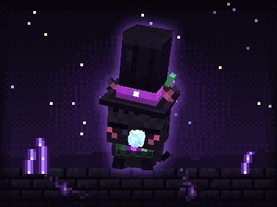

<p align="center">
  
</p>

<p align="center">
  <b>Noxis Culture</b> is a Fabric mod for Minecraft Java&nbsp;26.2.<br>
  It brings the Noxis to your world: small dark creatures with glowing eyes and tall hats.<br>
  Each one has a personality of its own.
</p>

<p align="center">
  <a href="#the-noxis-universe">The Universe</a>
  &nbsp;·&nbsp;
  <a href="#discover-their-world">Discover</a>
  &nbsp;·&nbsp;
  <a href="#small-lives-great-secrets">Secrets</a>
  &nbsp;·&nbsp;
  <a href="#installation">Installation</a>
</p>

<p align="center"></p>

## The Noxis Universe

<p align="center">
  
</p>

> *Deep below the deepslate, where the stone forgets the sun, there is a violet crystal called **Noxus**.*
> *Nobody knows who buried it there.*
> *The Noxis act as though they do.*
>
> *They are small and soft, dark as the hour before dawn, with eyes like two warm lanterns.*
> *They trade. They collect what shines. They make friends slowly and keep them close.*
> *And they never quite finish telling you their story.*

<p align="center"></p>

## Discover Their World

<p align="center"><sub><i>Illustrations rendered from the mod's own models. These are not gameplay footage.</i></sub></p>

<table>
  <tr>
    <td width="50%" align="center">
      <br>
      <b>Bonds</b><br>
      <sub>Some Noxis choose one friend and stay close to them for good.<br>Others would rather walk alone.</sub>
    </td>
    <td width="50%" align="center">
      <br>
      <b>Crystals</b><br>
      <sub>Amethyst and Noxus stop them in their tracks.<br>Watch their eyes when one is near.</sub>
    </td>
  </tr>
  <tr>
    <td width="50%" align="center">
      <br>
      <b>Readers &amp; Writers</b><br>
      <sub>A rare few carry a book everywhere they go.<br>What they write is not for you to read.</sub>
    </td>
    <td width="50%" align="center">
      <br>
      <b>Fishbowls</b><br>
      <sub>A little glass room to dream in.<br>The hat waits outside until morning.</sub>
    </td>
  </tr>
</table>

### Relics &amp; Materials

<p align="center">
  
</p>

- **Noxus** forms deep underground. Refine it into ingots, or set it as a block that gives off a faint violet glow.
- **Noyux** is a slow, corrosive violet liquid that eats into stone. Held in a cauldron, it can turn raw Noxus into ingots.
- **Noxite Bricks** are the dark stone of the Noxis. Their glowing variant smelts down into **Nixil**.
- The **Cosmos Pickaxe** carries the *Stellar Pulse*, which senses the ore veins hidden around you.
- **Noxis traders** value crystals, echoes and sculk. Their most loyal customers may leave with something cosmic.

### A Hat for Every Noxis

<p align="center">
  
</p>

<p align="center">
  <sub>Dye the crown and the band separately, with thousands of possible shades.<br>
  Set a hat down and it keeps every color exactly as it was.</sub>
</p>

<p align="center"></p>

## Small Lives, Great Secrets

<table>
  <tr>
    <td width="45%" align="center">
      
    </td>
    <td width="55%">
      Every Noxis is born with one of five temperaments.
      It shapes how they play, how they love and how often they get into trouble.<br><br>
      Their ears say what their faces won't. Some wear capes. Some carry a light into the dark.
      When the rain comes, they have a plan.<br><br>
      They settle in before they sleep and stretch when they wake.
      They keep small treasures, put things back where they belong, and leave gifts for the ones they care about.<br><br>
      <i>Some things only happen when you are not looking. Others, only when you are.</i>
    </td>
  </tr>
</table>

<p align="center">
  <sub>Some say the world looks different through their eyes.</sub>
</p>

<p align="center"></p>

## Installation

| Requirement | Version |
| :-- | :-- |
| Minecraft: Java Edition | **26.2** |
| Fabric Loader | **0.19.5** or newer |
| Fabric API | **0.161.0+26.2** or newer |
| Java | **25** (the official launcher provides it) |

1. Install **Fabric Loader** for Minecraft 26.2 with the [official Fabric installer](https://fabricmc.net/use/installer/).
2. Download **Fabric API** for 26.2 from [Modrinth](https://modrinth.com/mod/fabric-api) or [CurseForge](https://www.curseforge.com/minecraft/mc-mods/fabric-api).
3. Download **Noxis Culture**:
   1. Open the [**Actions**](../../actions) tab and select the latest successful **build** run.
   2. Under **Artifacts**, download **`noxis-culture-jar`**. You need to be signed in to GitHub.
   3. Unzip it and keep **`noxis-culture-1.0.0.jar`**. Skip the file that ends in `-sources.jar`.
4. Place both `.jar` files in your `.minecraft/mods` folder.
5. Start the game with the **Fabric** profile.

To meet your first Noxis, open the **Noxis Culture** creative tab and use the **Noxis Villager Spawn Egg**.

<details>
<summary><b>Building from source</b></summary>
<br>

Every push is built automatically by GitHub Actions. To build it yourself on a machine with Java 25:

```bash
./gradlew build
```

The mod is written to `build/libs/`.

</details>

<p align="center"></p>

<h3 align="center"><i>Look closely at the dark.<br>Something small is looking back.</i></h3>

<p align="center">
  <sub>
    The images on this page are illustrations rendered from the mod's own models and textures. They are not in-game screenshots.<br>
    Noxis Culture is a fan-made mod. It is not an official Minecraft product and is not approved by or associated with Mojang or Microsoft.<br>
    All rights reserved.
  </sub>
</p>
